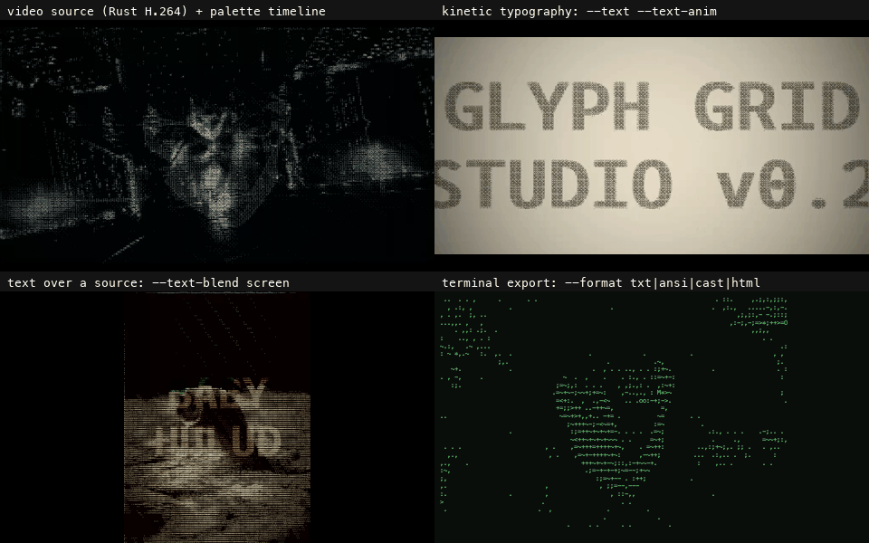

# Glyph Grid Studio

A real-time character-grid image renderer for macOS. Drop in any image and convert it to a tunable mosaic of typeset Unicode glyphs — ASCII, block elements, octants, sextants, braille — with live OKLab-palette interpolation, spatiotemporal blue-noise dithering, and a Lottes-style CRT-beam postprocess.

[](https://github.com/Joona-t/glyph-grid-studio/releases/latest)
[](LICENSE)
&nbsp;**Free · open source · macOS 11+ (Intel + Apple Silicon)**

🌐 **Website & download:** https://lovespark.love/glyph-grid-studio/

## Download

1. **[Download the latest release](https://github.com/Joona-t/glyph-grid-studio/releases/latest)** (`.dmg`), open it, drag **Glyph Grid Studio** into **Applications**.
2. **First launch (one time only).** The app is free and open source but isn't signed with a paid Apple Developer certificate, so macOS blocks the first open. To allow it:
   - **Right-click** (or Control-click) the app → **Open** → **Open** again in the dialog, **or**
   - **System Settings → Privacy & Security** → scroll down → **"Open Anyway"**, **or** run:
     ```bash
     xattr -dr com.apple.quarantine "/Applications/Glyph Grid Studio.app"
     ```

**Requirements:** macOS 11 (Big Sur) or later. Universal binary — runs natively on both Apple Silicon and Intel Macs.

Prefer to build it yourself? See [Build from source](#build) below.

## What's new in v0.2



Headless renders ~1.8× faster and byte-reproducible, default MP4s 4× smaller, a schema-validated CLI/MCP surface, terminal export (`--format txt|ansi|cast|html`), a keyframe timeline (`--timeline`), kinetic typography (`--text`, `--srt`) and video sources. Full before/after numbers: [docs/V0.2-REPORT.md](docs/V0.2-REPORT.md).

## What it does

The pipeline samples a source raster image into an `M × N` cell grid. For each cell, the renderer either:
- Picks a glyph from a luminance ramp (classic ASCII / block-shaded / gradient ramps), or
- Performs a 6-D shape-vector nearest-neighbor lookup against a pre-baked Unicode atlas (octants, sextants, blocks, braille) — the "shape-edge-aware" mode

The selected glyph is typeset into the cell, in a chosen palette and color mode. The output is a fully-composed character-grid — every pixel on the canvas is part of a typeset Unicode character.

## Tech stack

- **Front end:** [p5.js](https://p5js.org) 1.11 (single-file sketch)
- **Native shell:** [Tauri 2.x](https://tauri.app) (Rust backend, WKWebView front)
- **Rust crates:** `gifski` (high-quality palette GIF encoding, adaptive Twitter-fit shrink ladder), `openh264` + `mp4` (native MP4/H.264 export), `image`, `base64`, `tauri-plugin-dialog`, `tauri-plugin-fs`
- **UI:** [Tweakpane v3](https://cocopon.github.io/tweakpane/) — 70+ live-tunable bindings
- **Binary size:** ~10 MB arm64 macOS .app

## Features

| Axis | Options |
|---|---|
| Palettes (11) | monochrome, phosphor, bauhaus, lovespark, mono-amber, cyber-phosphor, amber-phosphor, bone-charcoal, cream-paper, silver-charcoal, spice |
| Color modes (4) | preserve, monochrome, duotone, gradient |
| Ramps (9) | classic, dense, sparse, unicode-block, gradient, gradientNoSpace, blockShaded, blockAscend, radial |
| Dithering (9) | none, bayer4, bayer8, blueNoise, **STBN** (NVIDIA EGSR 2022), temporal, floydSteinberg, atkinson, jarvisJudiceNinke |
| Selection (4) | brightness, shape, shape-edge-aware, edge-directional |
| Glyph sets (7) | ASCII, asciiDense, blockElements, braille, sextant, octant, ramp-only |
| Postprocess (8) | vignette, bloom, halation, scanlines, chromaticAberration, phosphorDecay, depthFog, **CRT-beam** (Lottes / Blur Busters 2024) |
| Animation | breathing-cell EMA, per-frame gain pulse, per-cell jitter — runtime-tunable · keyframe timeline on any CONFIG path (OKLab palette morphs) |
| Video source | MP4 / MOV / M4V / WebM as the input. H.264 decodes frame-exactly in Rust (openh264), so headless renders of a clip are deterministic. HEVC, VP9 and other codecs go through the WebView `<video>` with a seek per frame. Webcam source in the GUI (beta) |
| Text source | kinetic typography (typewriter / rise / fade / scale) and `.srt` / `.lrc` lyric cues rendered as the source, alone or composited onto the image (multiply / screen / mask) |
| Export | PNG snapshot · animated GIF89a · MP4 (H.264) · preset JSON · share URL |

## Privacy

Nothing leaves your machine: no telemetry, no network calls, no accounts. The webcam source (GUI › Video › camera (beta)) is **runtime-only state**. It is not part of the config, it is never saved in a preset or share URL, and `video.camera` is stripped from every preset, share link, batch job, MCP config and `--set` on the way in. A file someone sends you cannot switch your camera on; only that toggle can, and the headless CLI never opens a camera. Headless text exports (`--format txt|ansi|cast|html`) can only write the output path the job declared.

## Algorithmic notes

- **6-D shape-vector matching** (Alex Harri 2024): each glyph is encoded as 6 floats describing local mass distribution; per-cell lookup picks the closest match via k-d tree. Matches CNN-quality at ~1% the cost (Chen et al. arXiv 2503.14375, 2025).
- **STBN dithering**: a Halton(2,3)-driven approximation of NVIDIA's Spatiotemporal Blue Noise. Smoother per-frame variation than hash-jittered Bayer without shipping a 50 KB texture asset.
- **OKLCH palette interpolation**: cylindrical OKLab interpolation along the shorter hue arc, so palette transitions across distant hues stay saturated instead of dipping through gray.
- **Native GIF/MP4 encoding**: frames go straight from the JS canvas → Rust via base64 IPC. GIF through `gifski` (quality-100 palette encoding; the Twitter-fit path predicts the width that fits the 15 MB cap from the first pass's bytes-per-pixel, with at most one correction pass and a 360 px floor). MP4 through `openh264` + the `mp4` muxer for Instagram-compatible loops: `--mp4-quality upload` (default) is ~5 Mbps bitrate rate control, `archive` is fixed QP 26 (near-lossless, ~30-60 Mbps, the v0.1.x bitstream).

## Two ways to use it

### As a human — visual studio (GUI mode)

Drop image into the window, slide sliders, watch the canvas update live, click Export GIF when you have a look you like. Default behavior when launched with no arguments.

### As an agent / script — headless CLI

Same rendering pipeline, no GUI. Runs in an off-screen Tauri window, exits when the GIF is written.

```bash
# Single render with explicit flags
glyph-grid-studio render \
  --in ~/Downloads/portrait.jpg \
  --out ~/portrait-warm-bone.gif \
  --palette cream-paper \
  --color-mode monochrome \
  --ramp gradient \
  --dither stbn \
  --selection-mode shape-edge-aware \
  --glyph-set octant \
  --frames 24

# List every available palette / ramp / dither / glyph set
glyph-grid-studio catalog | jq

# Batch: render N variants of one or more sources in a SINGLE app session
# (~10x faster than per-variant render calls — startup + decode paid once).
# Manifest shape: {"version": 1, "in": "<default source>", "frames": N|"auto", "perf": false,
#   "jobs": [{"name", "out", "format": "gif|mp4|txt|ansi|cast|html", "in": "<per-job source>", "frames": N|"auto",
#             "capWidth": 720, "targetMaxBytes": 15728640, "border": {"width": 16},
#             "mp4Quality": "upload|archive", "config": {...}}]}
# capWidth 720 auto-targets Twitter's 15 MB cap (adaptive shrink ladder).
# Schema: src/glyph-grid.manifest.schema.json — unknown keys (a typo like
# "capwidth") and unknown versions fail with exit 2 in ~20 ms, before any render.
glyph-grid-studio batch --manifest variants.json

# Re-run an interrupted / timed-out batch: finished jobs are skipped.  Every
# batch job that lands writes a sidecar `<out>.ggs.json`
#   {"version":1,"frames":<requested>,"config_sha256":"…","bytes":…,"finished_at":<unix s>}
# and --resume skips a job only when its sidecar matches the requested frames,
# the job's config hash and the output's size (change the config → re-render).
# Outputs without a sidecar fall back to a validity check: a readable GIF with
# 1..=requested frames (gifski merges identical frames, so a still source can
# finish with fewer) or an MP4 with exactly the requested count.
glyph-grid-studio batch --manifest variants.json --resume

# Check a preset or manifest without rendering (exit 0 valid / 2 invalid).
# A file with a `jobs` key is a manifest and gets every pre-launch check
# `batch` runs (manifest schema, frames, border, each job config).
glyph-grid-studio validate variants.json

# Bound the wall time: past --timeout the render is killed (exit 3)
glyph-grid-studio render --in a.png --out a.gif --timeout 120

# Machine-readable progress on stderr (render and batch), one line per
# captured frame and encode step:
#   {"type":"progress","job":"cli","phase":"capture","frame":12,"total":120}
glyph-grid-studio render --in a.png --out a.gif --progress

# The grid as text (ITER-074): --format txt|ansi|cast|html, or just the
# extension (.txt .ans/.ansi .cast .html).  Every selection mode — the
# writers read the per-cell GlyphFrame the drawers fill, not pixels.
#   txt   rows x cols characters, one still frame (an LLM can read it)
#   ansi  the same frame with 24-bit colour escapes — `cat portrait.ans`
#   cast  asciinema v2 of --frames frames — `asciinema play portrait.cast`
#   html  one self-contained page: real characters, the bundled font
#         inlined, Play/Step controls, no autoplay under reduced motion
# Octant/sextant glyph sets under ansi/cast print a CR-8 warning: most
# terminal fonts lack those codepoints (html inlines a font that has them).
# Rough sizes at 240x120: txt 29 KB, ansi 30-300 KB (colour runs are
# merged), cast/html grow with how much changes per frame (a colourful
# 24-frame loop: cast ~8 MB, html ~3 MB).
glyph-grid-studio render --in portrait.jpg --out portrait.txt
glyph-grid-studio render --in worm.gif --out worm.cast --frames 48 --glyph-set blockElements

# Keyframes (ITER-075): animate any CONFIG path over the loop, Deforum-style
# `<u>:(<value>)[:linear|inOutSine|step]`, u in [0,1] of animation.duration.
# Numbers lerp, `palette` blends in OKLab, grid.cols/rows, glyphSet,
# selectionMode and dither.mode step.  Repeat --timeline for more tracks.
# Presets, batch manifests and MCP take the JSON form:
#   {"timeline":{"enabled":true,"tracks":{"palette":[{"u":0,"v":"cream-paper"},{"u":1,"v":"spice"}]}}}
glyph-grid-studio render --in a.png --out a.mp4 --frames auto \
  --timeline 'palette=0:(cream-paper),1:(spice)' \
  --timeline 'studio.breathing.gainSwing=0:(0.1),0.5:(0.6):inOutSine' \
  --timeline 'grid.cols=0:(80),0.5:(200)'

# Text as the source (ITER-076): no --in needed.  --srt takes .srt or .lrc;
# the last cue sets the loop length.  --text-anim typewriter|rise|fade|scale,
# --text-font 'Cascadia Mono'|'IBM VGA8'|<system font>, --text-size <px at 512 px>.
# With --in, --text-blend multiply|screen|mask composites onto the image.
# JSON form: the `textSource` preset key (src/glyph-grid.schema.json).
glyph-grid-studio render --text 'DROP' --text-anim typewriter --out drop.gif
glyph-grid-studio render --srt lyrics.lrc --text-anim rise --frames auto --out lyrics.mp4
glyph-grid-studio render --in photo.jpg --text 'HELLO' --text-blend mask --out hello.gif

# Video as the source (ITER-077): --in takes .mp4 / .mov / .m4v / .webm.
# The loop is the clip's length (--frames auto = all of it at the output fps).
# --video-decode auto (default: H.264 in Rust, other codecs in the WebView) |
# native (Rust only, non-H.264 is an error) | webview.  JSON: `video.decode`.
# Limits are the image ones: <= 480 frames, <= 64 MB; trim longer clips first.
glyph-grid-studio render --in clip.mp4 --frames auto --out clip-glyphs.mp4

# Help
glyph-grid-studio render --help
glyph-grid-studio batch --help
```

**Exit codes** (`render` and `batch`):

| Code | Meaning |
|---|---|
| `0` | Success — every output written. |
| `1` | Render or encode failed (for `batch`: at least one job failed; the others are still written). |
| `2` | Bad input: usage error, unreadable source / preset / manifest, config that fails the schema. Only ever before the app window starts — an app session that ends without a result is `1`. |
| `3` | Timed out: `--timeout <seconds>` elapsed, or no render progress for 300 s (a stalled WebView). The render is killed and its `.part` temp files removed. |
| `130` / `143` | Interrupted by Ctrl-C (SIGINT) / SIGTERM. The render stops within ~0.1 s and its `.part` temp files are removed; finished outputs are never partial (writes are atomic). |

### As a Claude / Cursor tool — MCP server

Wire it into any MCP-aware AI client and the renderer becomes a native tool. Edit `~/Library/Application Support/Claude/claude_desktop_config.json`:

```json
{
  "mcpServers": {
    "glyph-grid-studio": {
      "command": "/Applications/Glyph Grid Studio.app/Contents/MacOS/glyph-grid-studio",
      "args": ["mcp"]
    }
  }
}
```

Restart Claude Desktop. Then in any chat:

> *"Render the image at ~/Pictures/sunset.jpg as a cream-paper monochrome glyph drawing using shape-edge-aware octant selection. Save it next to the original."*

Tools exposed: `glyph_grid_render`, `glyph_grid_batch`, `glyph_grid_catalog`. Failures come back as `isError` results carrying `{code, path, message}`. Full setup + agentic-exploration examples in [docs/mcp.md](docs/mcp.md).

## Build

```bash
# Prereqs: Rust 1.77+, Cargo, Xcode CLI tools
cd src-tauri
cargo tauri build       # ~40 s incremental, ~3 min cold
# output: src-tauri/target/release/bundle/macos/Glyph Grid Studio.app
```

To install:
```bash
ditto "src-tauri/target/release/bundle/macos/Glyph Grid Studio.app" \
      "$HOME/Applications/Glyph Grid Studio.app"
xattr -cr "$HOME/Applications/Glyph Grid Studio.app"
open "$HOME/Applications/Glyph Grid Studio.app"
```

The headless binary is at `Glyph Grid Studio.app/Contents/MacOS/glyph-grid-studio`. After v0.2's Homebrew cask, it will be on `$PATH` as `glyph-grid-studio`.

## Project layout

```
src/
  index.html            single-file p5 sketch (CONFIG, scenes, draw loop, testHook)
  lib/
    glyph-fonts.js      WOFF2 cascade + sentinel availability detection
    glyph-dither.js     ordered + error-diffusion + STBN dithering
    glyph-palette-morph.js  OKLab/OKLCH interpolation
    glyph-shape-index.js    6-D vectors + k-d tree NN selection
    glyph-crt.js        postprocess chain (vignette → CRT-beam)
    glyph-studio.js     Tweakpane bindings + drag-drop + recording + exports
    ...
  glyph-sets/           pre-baked atlas JSONs (ASCII, octant, sextant, braille…)
  fonts/                bundled WOFF2 (Cascadia + IBM VGA fallback)

src-tauri/
  src/lib.rs            Tauri commands: save_png, save_gif_real, save_gif_to_path,
                        pick_image, read_image_file, save_preset_json, load_preset_json
  Cargo.toml            tauri 2.10, gif 0.13, image 0.25
  tauri.conf.json       window 1500×820, dragDropEnabled, withGlobalTauri, devtools
  capabilities/         core:default, dialog, fs
```

## Test session

A 469-GIF Cartesian feature test was run during development to verify every code path renders cleanly. See `BUGS_AND_ITERATIONS.md` for the bug log + summary. The test driver functions (`runStudioPhase(N)` / `runAllStudioPhases()`) are still available in the build for regression testing.

## License

[MIT](LICENSE) — Joona Tyrninoksa, 2026
